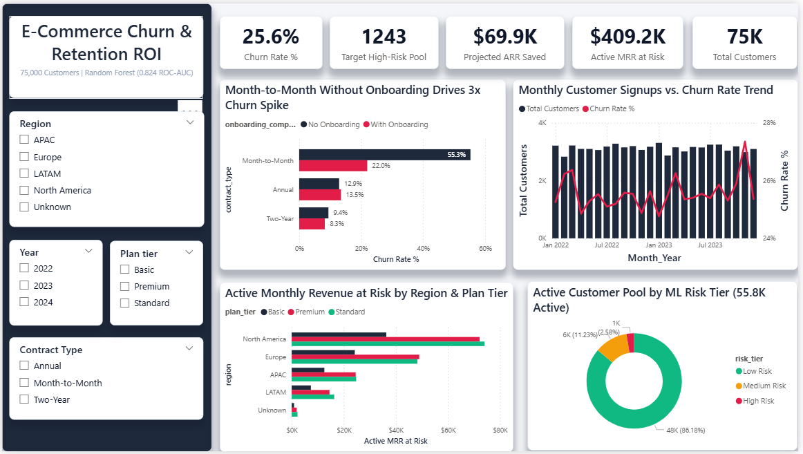

# E-Commerce Customer Churn & Retention ROI Intelligence



## Executive Summary
An end-to-end customer churn analytics and revenue protection pipeline built across **PostgreSQL**, **Python**, and **Power BI** on a 4-table relational dataset of **75,000 customers**.

Rather than stopping at model accuracy, this project isolates high-risk subscriber segments, validates behavioral churn drivers statistically, scores active accounts for churn probability, and models the financial ROI of a targeted retention campaign.

* **Baseline Churn Rate:** **25.6%** across 75,000 total customers (**55,835** currently active).
* **Primary Churn Driver:** Month-to-Month subscribers who skip onboarding churn at **55.3%**—more than **2.5x** the rate of onboarded Month-to-Month peers (**22.0%**).
* **Active Revenue Exposure:** **$409.2K/mo** in probability-weighted Monthly Recurring Revenue (MRR) at risk across active accounts, concentrated heavily in North America (`~$180K/mo`) and Europe (`~$122K/mo`).
* **Projected Campaign ROI:** Targeting the **1,243** high-risk, un-onboarded Month-to-Month active accounts ($49.1K/mo exposed MRR) with a 14-day onboarding intervention (assuming a 25% conversion rate to the 21.96% onboarded baseline) projects **$69,859 ($69.9K) in Annual Recurring Revenue (ARR) saved**.

---

## Tech Stack & Architecture
* **Data Engineering & Simulation:** Python (`pandas`, `numpy`) — generated 4 normalized relational tables (`customers`, `subscriptions`, `support_tickets`, `orders_summary`) with intentional data anomalies (1,000 missing regions, 200 duplicate records).
* **Database Modeling & SQL:** PostgreSQL — deduplication via `ROW_NUMBER()` window functions, null imputation (`COALESCE`), multi-table CTEs, MRR loss quantification, and Month 1/3/6/12 cohort retention matrices.
* **Statistical Validation & Machine Learning:** Python (`scipy`, `scikit-learn`) — Chi-Square hypothesis testing, Logistic Regression (Odds Ratios), and Random Forest classification for probability scoring.
* **Business Intelligence:** Power BI Desktop — custom JSON theme, Star Schema data model (`Fact_Customer_Churn` + 3 Dimensions), and DAX financial ROI measures.

---

## Key Analytical Findings

### 1. Statistical Hypothesis Validation (Python `scipy`)
* **Test:** Chi-Square Test of Independence evaluating `onboarding_completed` vs. `churned` within Month-to-Month contracts.
* **Result:** Chi-Square = `4875.69`, `p < 0.0001` — confirming that onboarding completion has a highly statistically significant impact on early retention.

### 2. Predictive Churn Modeling (`03_churn_model_roi.ipynb`)
| Model | ROC-AUC | Recall (Churn Class) | Primary Role in Pipeline |
| :--- | :---: | :---: | :--- |
| **Random Forest Classifier** | **0.824** | 72.3% | Non-linear probability scoring & `revenue_at_risk` calculation |
| **Logistic Regression** | 0.813 | **74.0%** | Directional Odds Ratios for stakeholder interpretability |

### 3. Active Customer Risk Segmentation (`55,835` Active Accounts)
* **High Risk (`> 60%` churn prob):** **1,442** customers (`69%` avg churn probability | **$39.1K/mo** weighted MRR at risk)
* **Medium Risk (`35%–60%` churn prob):** **6,272** customers (`45%` avg churn probability | **$114.6K/mo** weighted MRR at risk)
* **Low Risk (`< 35%` churn prob):** **48,121** customers (`13%` avg churn probability | **$255.4K/mo** weighted MRR)

---

## Repository Structure
```text
ecommerce-churn-retention/
├── data/
│   ├── raw/                  # 4 relational CSVs with simulated noise
│   └── cleaned/              # Scored fact_customer_analytics.csv (75,000 rows)
├── sql/
│   ├── 01_schema_load.sql
│   ├── 02_data_cleaning.sql
│   ├── 03_churn_drivers_cte.sql
│   └── 04_cohort_retention_window.sql
├── python/
│   ├── 01_generate_relational_data.py
│   ├── 02_eda_stat_testing.ipynb
│   └── 03_churn_model_roi.ipynb
├── powerbi/
│   ├── ECommerce_Churn_Executive_Dashboard.pbix
│   └── executive_churn_theme.json
├── assets/
│   └── dashboard_preview.png
└── README.md
